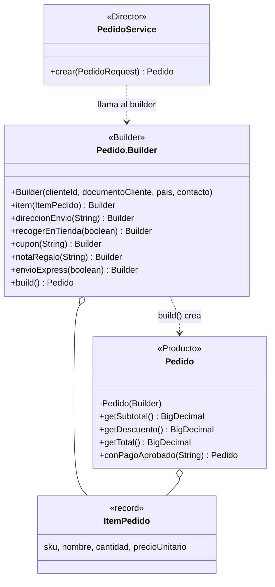
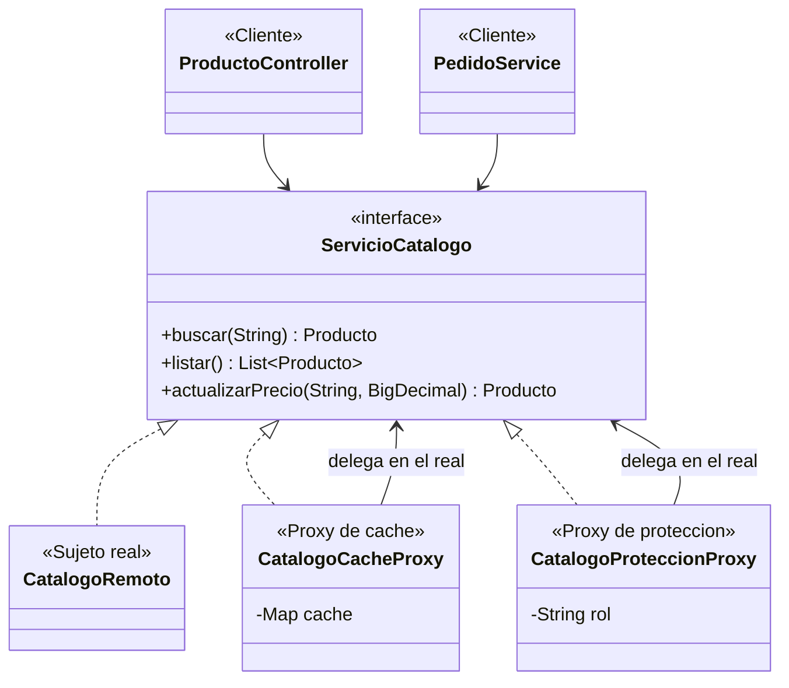
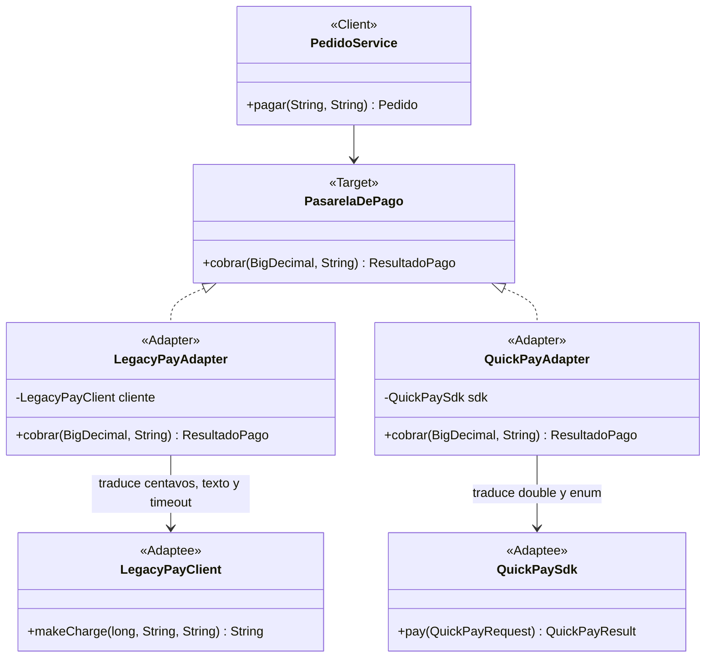
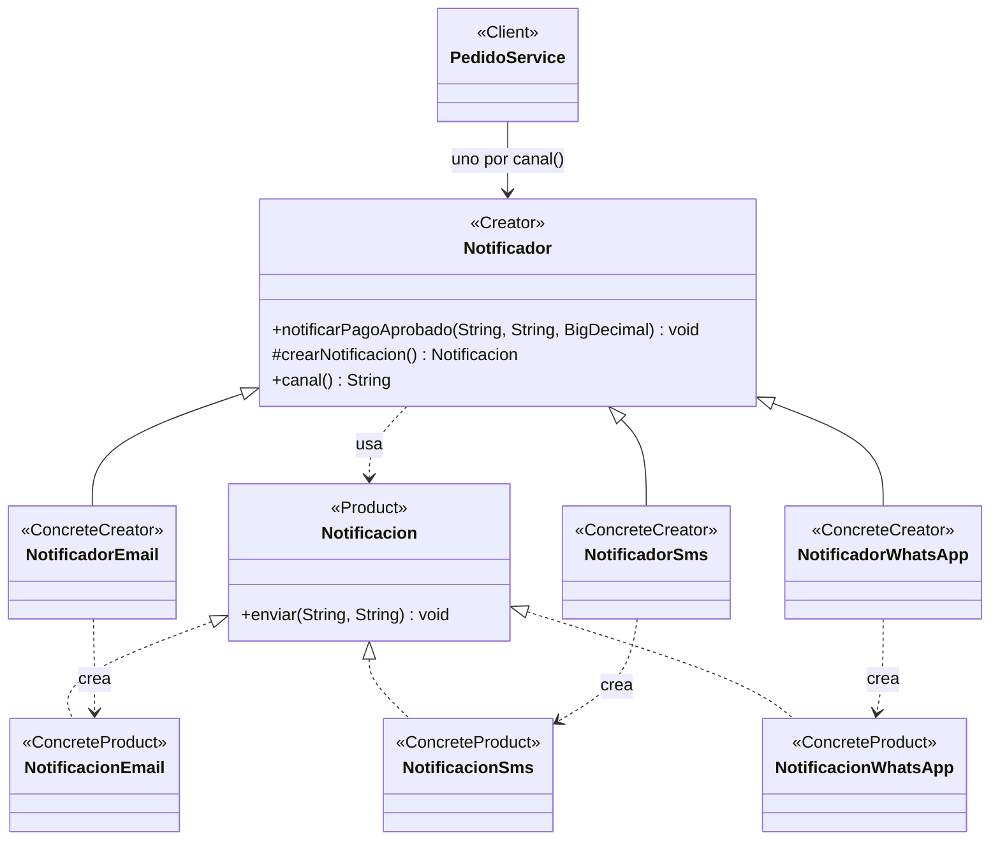
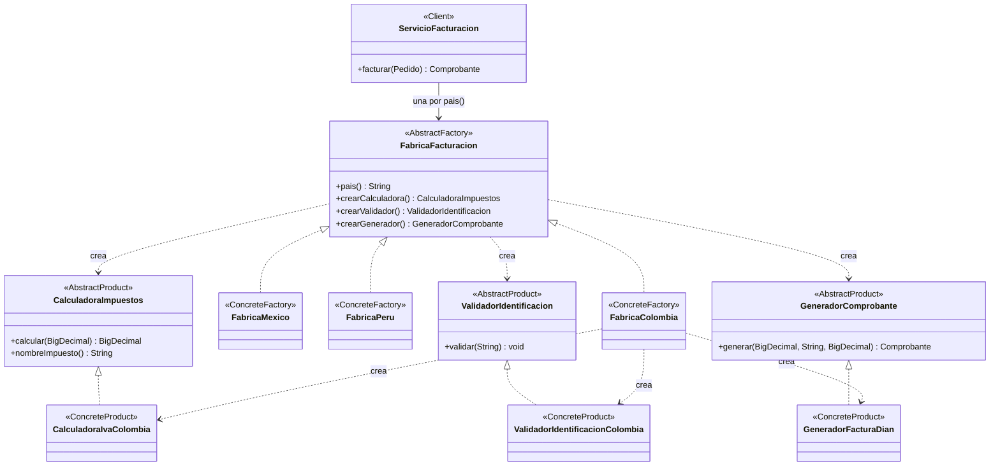
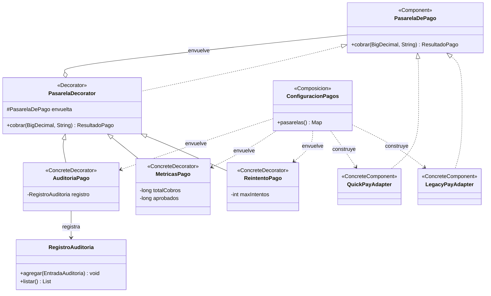

# ShopFlow · proyecto base del taller de patrones de diseño

Ingeniería de Software 2 · Taller: patrones de diseño creacionales y estructurales en una API REST.

## 1. Integrantes, roles y cómo ejecutar

### Integrantes y roles

| Integrante | Patrones | Reto de extensión |
|---|---|---|
| Mayer Santiago Torres Sánchez | Abstract Factory y Decorator | Reto A (Perú) y Reto B (Métricas) |
| [Nombre del integrante 2] | [Patrones] | [Reto] |
| [Nombre del integrante 3] | [Patrones] | [Reto] |

Cada integrante trabajó en su propia rama y la integró a `main` mediante un pull request.

### Cómo ejecutar
Requisitos: Java 17 o superior y Maven (o un IDE con soporte para Maven).

```bash
mvn spring-boot:run
```
La API queda en `http://localhost:8080`. Para correr las pruebas unitarias:

```bash
mvn test
```

Las salidas de los escenarios del guion de pruebas y los `git diff --stat` de cada reto están en la carpeta `evidencias/`.

### Qué trae este proyecto
| Paquete | Contenido | ¿Se modifica? |
|---|---|---|
| `externos.legacypay`, `externos.quickpay` | SDK simulados de los proveedores de pago | **No** |
| `catalogo.CatalogoRemoto` | Catálogo de otro equipo (1,5 s por llamada) | **No** |
| `catalogo.ServicioCatalogo`, `Producto` | Interfaz del catálogo y producto | Provisto |
| `pagos.PasarelaDePago`, `ResultadoPago`, `PasarelaNoDisponibleException` | Interfaz destino y tipos propios de ShopFlow | Provisto |
| `pedidos.PedidoRequest` | JSON de entrada de `POST /api/pedidos` | Provisto |
| `notificaciones.BandejaNotificaciones` | Simula el envío de notificaciones | Provisto |
| `comun.ManejadorErrores` | Excepciones → códigos HTTP | Provisto |

Todo lo demás (controladores, servicios, configuraciones y las clases de cada patrón) se implementa durante el taller. Las indicaciones están en el documento del taller (instrucciones y anexos A a D).


## 2. Tabla de análisis de patrones

| Patrón | Problema en ShopFlow (síntoma) | Participantes GoF → clases | Principio SOLID | Cuándo no usarlo |
|---|---|---|---|---|
| *Ejemplo: Strategy* | El costo de envío se calcula con un switch por tipo (estándar, express, recoger en tienda) que crece con cada opción nueva. | Strategy: EstrategiaEnvio. ConcreteStrategy: EnvioEstandar, EnvioExpress. Context: ServicioEnvio. | OCP y DIP. | Si solo hay dos variantes que casi nunca cambian, un if es más claro. |
| Factory Method | Al aprobarse un pago hay que notificar al cliente por el canal que eligió (correo o SMS hoy; WhatsApp después). El proceso es siempre el mismo y lo único que cambia es cómo se crea y se envía cada mensaje. Si PedidoService decide con un if qué clase instanciar, cada canal nuevo obliga a modificarlo. | Product: Notificacion. ConcreteProduct: NotificacionEmail, NotificacionSms, NotificacionWhatsApp. Creator: Notificador. ConcreteCreator: NotificadorEmail, NotificadorSms, NotificadorWhatsApp. Client: PedidoService. | OCP, DIP y SRP. | Cuando hay un solo producto que no cambia, una jerarquía de creadores es más compleja que el new que reemplaza. Conviene empezar con un new y pasar a Factory Method cuando el condicional empiece a repetirse o a crecer. |
| Abstract Factory | Existe una familia de objetos que van juntos: si un pedido se valida con reglas de otro país, la factura queda mal. Si usamos un if en cada clase se mezcla validar un pedido mexicano con reglas colombianas, y al agregar Perú obliga a modificar todo el código. | AbstractFactory: FabricaFacturacion. ConcreteFactory: FabricaColombia, FabricaMexico, FabricaPeru (reto A). AbstractProduct: CalculadoraImpuestos, ValidadorIdentificacion, GeneradorComprobante. ConcreteProduct: implementaciones de cada país. Client: ServicioFacturacion. | OCP y DIP. | Cuando no hay familias de productos, también cuando la familia cambia seguido: agregar un producto nuevo obliga a modificar la interfaz y todas las fábricas. |
| Builder | Un pedido tiene 4 datos obligatorios, al menos un ítem y 6 opciones (dirección, recoger en tienda, cupón, nota de regalo, envío express y canal de notificación), y algunas reglas dependen de varias opciones a la vez. Con un constructor de 11 parámetros es fácil mezclar el orden de dos String, y con setters el pedido puede quedar incompleto o inválido. | Producto: Pedido, inmutable y con constructor privado. Builder: Pedido.Builder, clase estática anidada (versión de Bloch); las reglas se validan en build(). Quien dirige la construcción: PedidoService.crear(PedidoRequest), que traduce el JSON a llamadas al builder. Apoyo: ItemPedido, cuyo precio se toma del catálogo y no del cliente. | SRP: Pedido representa el pedido y Pedido.Builder se encarga de construirlo y validarlo. | Cuando el objeto tiene dos o tres parámetros y todos son obligatorios, porque el builder solo duplicaría código. También hay que mantenerlo cada vez que el pedido cambia de atributos. |
| Adapter | ShopFlow cobra con dos proveedores cuyos SDK no se pueden modificar y no coinciden entre sí ni con el modelo propio. LegacyPay recibe centavos, responde un texto como "00\|LP4051" y lanza su propia excepción por timeout; QuickPay recibe un double y responde con un enum. Sin patrón, los centavos, los códigos y los enums quedan regados por la lógica de negocio, y cambiar de proveedor obliga a reescribirla. | Target: PasarelaDePago. Adapter: LegacyPayAdapter, QuickPayAdapter. Adaptee: LegacyPayClient, QuickPaySdk. Client: PedidoService. | OCP, SRP y DIP. | Cuando se controlan las dos interfaces, porque es más simple alinearlas directamente. También cuando lo que se quiere es simplificar un subsistema completo: eso es Facade. |
| Decorator | LegacyPay falla con timeout casi el 30 % de las veces y hay que reintentar; auditoría exige registrar cada cobro de los dos proveedores. En pruebas los reintentos deben poder apagarse. Con herencia tocaría poner muchas subclases y cada capa nueva duplicaría la cuenta. | Component: PasarelaDePago. ConcreteComponent: LegacyPayAdapter, QuickPayAdapter. Decorator: PasarelaDecorator. ConcreteDecorator: ReintentoPago, AuditoriaPago, MetricasPago (reto B). | OCP, SRP y LSP. | Cuando hay muy pocas combinaciones. También cuando el cliente depende de tipos concretos. |
| Proxy | El catálogo es de otro equipo y cada consulta tarda 1,5 segundos; un pedido de 3 productos tardaría 4,5 s solo en consultar precios. Además, solo el ADMIN puede cambiar precios, y sin proxy ese control se copiaría en cada lugar que cambia un precio. | Sujeto: ServicioCatalogo. Sujeto real: CatalogoRemoto (simula los 1,5 s de red). Proxy de caché: CatalogoCacheProxy, guarda los productos y solo llama al remoto si el SKU no está en caché; al cambiar un precio actualiza su caché para no servir uno viejo. Proxy de protección: CatalogoProteccionProxy, lanza AccesoDenegadoException (403) si el rol no es ADMIN. Clientes: ProductoController y PedidoService, que reciben un ServicioCatalogo sin saber que es un proxy. | LSP: cada proxy puede reemplazar al catálogo real sin que el cliente lo note. También SRP (la caché y los permisos salen del objeto real) y OCP (se agrega control sin modificar CatalogoRemoto). | Cuando el objeto es barato y local, porque la capa extra no aporta nada. También cuando se necesitan datos siempre frescos y no se puede saber cuándo la caché quedó vieja (por ejemplo, si otro sistema cambia el precio directamente en el catálogo remoto). Y cuando ocultar la red haría creer que una llamada es barata. |


## 3. Patrones: problema, diagrama de clases y endpoint

### Builder

**Problema que resuelve en ShopFlow:** un pedido tiene 4 datos obligatorios, al menos un ítem y 6 opciones, con reglas que dependen de varias opciones a la vez. Con un constructor largo es fácil confundir el orden de los parámetros, y con setters el pedido puede quedar incompleto o inválido. Con el Builder, `build()` valida todo y solo entrega pedidos válidos.

**Endpoint que lo evidencia:** `POST /api/pedidos`. Responde 201 con el pedido, o 400 si rompe alguna regla.



### Proxy

**Problema que resuelve en ShopFlow:** el catálogo es de otro equipo y cada consulta tarda 1,5 segundos. Además, solo un ADMIN puede cambiar precios. Con los proxies, la caché y el control de acceso quedan fuera del catálogo real y ningún cliente se entera de que habla con un intermediario.

**Endpoints que lo evidencian:** `GET /api/productos/{sku}` (la segunda consulta responde casi al instante) y `PUT /api/productos/{sku}/precio` (403 con `X-Rol: CLIENTE`, 200 con `X-Rol: ADMIN`).




### Adapter

**Problema que resuelve en ShopFlow:** ShopFlow cobra con dos proveedores cuyos SDK no se pueden modificar y no coinciden entre sí ni con el modelo propio. LegacyPay recibe el monto en centavos, responde un texto como `"00|LP4051"` y lanza su propia `LegacyPayTimeoutException`. QuickPay recibe un `double` y responde con un enum. Con los adapters, el dominio solo conoce `PasarelaDePago.cobrar(BigDecimal, String)` y recibe un `ResultadoPago`; cambiar de proveedor es agregar otro adapter.

**Endpoint que lo evidencia:** `POST /api/pedidos/{id}/pago` con `{"proveedor": "LEGACYPAY"}` o `{"proveedor": "QUICKPAY"}`. Responde 200 con el pedido pagado, 400 si el proveedor no existe, 404 si el pedido no existe, 409 si el cobro se rechaza (por ejemplo, «Fondos insuficientes» por más de 2.000 USD con LegacyPay) o si el pedido ya estaba pagado, y 503 si la pasarela no responde.



### Factory Method

**Problema que resuelve en ShopFlow:** al aprobarse un pago se notifica al cliente por el canal que eligió. El proceso es siempre el mismo (armar el mensaje, crear la notificación del canal y enviarla) y lo que cambia es la notificación: un correo exige un contacto con «@» y lleva asunto, un SMS se recorta a 160 caracteres y WhatsApp exige un número con indicativo. Si `PedidoService` eligiera con un `if` qué clase instanciar, cada canal nuevo obligaría a modificarlo. Con el Factory Method, `Notificador.notificarPagoAprobado()` fija el proceso y cada subclase decide qué `Notificacion` crea. `PedidoService` recibe la lista de notificadores y los indexa por `canal()`.

**Endpoints que lo evidencian:** `GET /api/notificaciones` muestra las notificaciones enviadas con su canal y el total pagado. `POST /api/pedidos` responde 400 si el pedido trae un `canalNotificacion` que ningún notificador atiende.




### Abstract Factory

**Problema que resuelve en ShopFlow:** cada país exige una familia de piezas que deben ir juntas: el impuesto, la validación del documento del cliente y el comprobante electrónico. Colombia usa IVA del 19 %, cédula o NIT y «Factura electrónica (DIAN)»; México usa IVA del 16 %, RFC y «CFDI (SAT)». Con un `if` por país en cada pieza es fácil mezclar reglas de países distintos, y abrir un país nuevo obliga a modificar el código que factura. Con el Abstract Factory, `ServicioFacturacion` recibe una `FabricaFacturacion` por país que entrega las tres piezas ya emparejadas, y un país nuevo es una fábrica nueva.

**Endpoint que lo evidencia:** `POST /api/pedidos`. Responde 201 con el pedido y su `comprobante` (tipo, número, base, impuesto y total), o 400 si el documento no corresponde al país del pedido o si ningún país atiende ese código.



Por claridad, el diagrama muestra los productos concretos de Colombia. México (`CalculadoraIvaMexico`, `ValidadorIdentificacionMexico`, `GeneradorCfdiMexico`) y Perú (`CalculadoraIgvPeru`, `ValidadorIdentificacionPeru`, `GeneradorFacturaSunat`) tienen las mismas tres clases implementando las mismas interfaces.

### Decorator

**Problema que resuelve en ShopFlow:** LegacyPay falla con timeout casi el 30 % de las veces, así que conviene reintentar, y auditoría exige registrar cada cobro de los dos proveedores (proveedor, monto, resultado y duración). Además, en pruebas los reintentos deben poder apagarse. Con herencia haría falta una subclase por cada combinación de proveedor y capa, y cada capa nueva duplicaría la cuenta. Con el Decorator, `ReintentoPago` y `AuditoriaPago` envuelven a cualquier `PasarelaDePago`, y `ConfiguracionPagos` arma las capas según las propiedades `shopflow.pagos.reintentos` y `shopflow.pagos.auditoria`.

**Endpoints que lo evidencian:** `GET /api/pagos/auditoria` (200 con una entrada por cobro: proveedor, monto, resultado y duración) y `POST /api/pedidos/{id}/pago` (con LegacyPay, casi todos los pagos se aprueban a pesar de los timeouts, porque se reintenta).



El orden de las capas es adapter, luego reintento, luego métricas y, por fuera, auditoría. Así hay una entrada de auditoría por cobro y no una por intento, y las métricas cuentan cobros completos: un pago que necesita tres intentos cuenta como un aprobado, no como dos rechazados y uno aprobado.


## 4. Retos de extensión

### Reto A · Perú (Abstract Factory)

Se agregó la familia de Perú en el paquete `facturacion.peru`, solo con archivos nuevos: `FabricaPeru` (`@Component`, `pais()` devuelve `"PE"`), `CalculadoraIgvPeru` (IGV del 18 %), `ValidadorIdentificacionPeru` (RUC de exactamente 11 dígitos) y `GeneradorFacturaSunat` («Factura electrónica (SUNAT)»), más la prueba `ServicioFacturacionPeruTest`. No se modificó ninguna clase existente: Spring inyecta la nueva fábrica en la lista que recibe `ServicioFacturacion`, que ya arma el mapa por `pais()`, así que un pedido con `"pais": "PE"` se factura sin tocar nada más.

Evidencia de que solo hay archivos nuevos: la salida de `git diff --stat` del commit del reto está en `evidencias/reto-a-git-diff-stat.txt` (5 archivos, 139 inserciones, 0 borrados).

### Reto B · Métricas (Decorator)


Se agregó el decorador `MetricasPago`, que cuenta los cobros y los aprobados de cada pasarela y escribe en consola la tasa de aprobación después de cada cobro. Quedó entre la auditoría y el reintento. La única clase existente que se modificó fue `ConfiguracionPagos`, el punto de composición, para agregar la capa nueva a la cadena; `PasarelaDecorator`, `ReintentoPago`, `AuditoriaPago` y los adapters quedaron intactos.

Evidencia: la salida de `git diff --stat` del commit del reto está en `evidencias/reto-b-git-diff-stat.txt`. Muestra solo archivos nuevos (`MetricasPago` y su prueba) y `ConfiguracionPagos`, con 2 líneas borradas: las dos llamadas dentro del `@Bean`.

### Reto C · WhatsApp (Factory Method)

Se agregaron `NotificacionWhatsApp` (exige un número con indicativo, por ejemplo `+573001234567`, y antepone ✅ al mensaje) y `NotificadorWhatsApp` (`@Component`, `canal()` devuelve `"WHATSAPP"`). No se modificó ninguna clase existente: Spring inyecta el nuevo notificador en la lista que recibe `PedidoService`, que ya los indexa por canal, así que un pedido con `"canalNotificacion": "WHATSAPP"` se notifica sin tocar nada más.

Evidencia de que solo hay archivos nuevos: la salida de `git show --stat` del commit `67dc2c9` está en `evidencias/reto-c-git-diff-stat.txt` (3 archivos, 88 inserciones, 0 borrados). El stat está filtrado por las tres rutas del reto (`NotificacionWhatsApp`, `NotificadorWhatsApp` y `NotificadorWhatsAppTest`), porque ese commit también incluye el trabajo de los patrones Adapter y Factory Method.


## 5. Preguntas de reflexión

**1. Escriba cómo habría quedado `PedidoService` sin Factory Method ni Abstract Factory: ¿cuántos `if` tendría y qué clases habría que modificar para abrir Perú y agregar WhatsApp?**

Sin los patrones, PedidoService tendría los `if` metidos en la misma clase. Para notificar haría falta uno por canal que haga el `new` de la notificación: 2 hoy (correo y SMS) y 3 con WhatsApp. Para facturar, uno por país en cada una de las tres piezas (calcular el impuesto, validar el documento y generar el comprobante): 2 países por 3 piezas son 6 hoy y 9 con Perú. En total serían unos 8 `if` hoy y 12 con Perú y WhatsApp, todos en PedidoService.

Para abrir Perú y agregar WhatsApp habría que entrar a PedidoService y tocar cada uno de esos `if`, con el riesgo de dañar lo que ya funciona. Con los patrones no se modificó ninguna clase existente: Perú es la clase nueva FabricaPeru y WhatsApp es NotificadorWhatsApp. PedidoService y ServicioFacturacion no cambian, porque Spring les inyecta las fábricas y los notificadores y ellos los guardan por pais() y canal().

**2. ¿Por qué las notificaciones usan Factory Method y la facturación usa Abstract Factory? Responda con la diferencia entre crear un producto y crear una familia de productos.**

La diferencia está en cuántos objetos hay que crear y qué tienen que cumplir entre ellos. En las notificaciones se crea un solo producto: la `Notificacion` del canal. El proceso (armar el mensaje y enviarlo) es siempre igual, y la subclase (`NotificadorEmail`, `NotificadorSms`) decide cuál crea sobrescribiendo `crearNotificacion()`. Eso es Factory Method y funciona por herencia.

En la facturación se crea una familia de productos que tienen que ir juntos: la calculadora de impuestos, el validador de documento y el generador de comprobante del mismo país. Si se mezclan (el IVA de Colombia con el CFDI de México), la factura queda mal. `ServicioFacturacion` recibe una `FabricaFacturacion` que entrega las tres piezas ya emparejadas, y eso es Abstract Factory, que funciona por composición. Si solo se elige un objeto, es Factory Method; si hay que garantizar que varios objetos sean compatibles entre sí, es Abstract Factory.

**3. Invierta el orden de los decoradores (reintento por fuera de la auditoría) y pague cinco pedidos con LegacyPay. ¿Qué cambia en `GET /api/pagos/auditoria`? ¿Qué orden conviene y por qué?**

Respuesta: Con la auditoría por fuera, que es el orden que dejamos en ConfiguracionPagos, cada pago pasa una sola vez por AuditoriaPago. Esta mide el tiempo, le pasa el cobro a ReintentoPago y al final guarda una entrada con el resultado final y lo que tardó en total, reintentos incluidos. En nuestra corrida, al pagar cinco pedidos con LegacyPay, GET /api/pagos/auditoria mostró exactamente 5 entradas, aunque dos de esos pagos tardaron unos 910 ms porque se reintentaron por dentro.

Al invertir el orden, el reintento queda por fuera y llama a AuditoriaPago en cada intento. Entonces cada timeout queda como una entrada fallida y el intento que sale bien queda como otra, cada una con la duración de un solo intento. En nuestra corrida con el orden invertido, los mismos cinco pagos dejaron 7 entradas: 4 aprobadas y 3 de error. Las 3 de error son los tres timeouts seguidos de un mismo pedido, que respondió 503 y por eso no tiene entrada aprobada. El número exacto cambia en cada ejecución porque los timeouts de LegacyPay son aleatorios (cerca del 30 %), y las dos corridas quedaron guardadas en evidencias/reflexion-3.txt.

Conviene el primer orden. Auditoría pide registrar cada cobro, y con la auditoría por fuera hay una entrada por cobro con su resultado y su duración total. Con el orden invertido el registro mezcla reintentos con cobros, y ya no se sabe cuántos pagos se hicieron.

**4. `CatalogoCacheProxy` y `AuditoriaPago` tienen casi la misma estructura: implementan la interfaz y envuelven un objeto. ¿Por qué uno es Proxy y el otro Decorator?**

Aunque tienen la misma estructura, la diferencia está en la intención. `CatalogoCacheProxy` controla el acceso al catálogo remoto: decide si llama o no al objeto real. Si el SKU ya está en caché, responde sin llamar al `CatalogoRemoto`. El cliente no recibe nada nuevo, solo obtiene la misma respuesta más rápido. `AuditoriaPago` siempre delega en la pasarela y además agrega una responsabilidad nueva: registrar cada cobro con su duración y su resultado. Si el envoltorio controla si, cuándo o cómo se llega al objeto real, es Proxy. Si le agrega funcionalidad que el cliente quiere, es Decorator.

**5. Si otro sistema cambia un precio directamente en el catálogo remoto, ¿qué problema tiene la caché del proxy? Proponga una solución.**

La caché solo se entera de los cambios que pasan por ella (cuando se llama a `actualizarPrecio` en el proxy). Si otro sistema cambia el precio directamente en el catálogo remoto, la caché sigue guardando el precio viejo y lo sirve, por lo que un pedido podría calcularse con un precio desactualizado. Una solución sencilla es que cada producto guardado en caché tenga un tiempo de vida (TTL), por ejemplo unos minutos, y cuando venza se vuelva a consultar al catálogo remoto. Otra opción es que el catálogo remoto avise cuando cambia un precio para invalidar esa entrada de la caché.

**6. `QuickPayAdapter` convierte `BigDecimal` a `double`. ¿Qué riesgo trae y por qué conviene que esa decisión viva en el adapter y no en el dominio?**

El riesgo es que un `double` guarda los decimales en binario y casi ninguno queda exacto: `19.99` se almacena como 19.9899999999999984…, así que si el SDK lo multiplica por 100 y trunca, obtiene 1998 centavos en vez de 1999. En dinero eso es un centavo perdido, y con muchas operaciones se acumula. En este ejercicio el SDK de QuickPay solo compara el monto contra 0 y 5.000, así que no pasa nada, pero el riesgo es real con cualquier SDK que calcule con ese número.

Conviene que la conversión viva en el adapter porque ahí está la frontera con el SDK. El dominio (`Pedido`, `ResultadoPago`, `PasarelaDePago`) sigue trabajando con `BigDecimal`, que es exacto, y solo `QuickPayAdapter.cobrar()` asume la pérdida de precisión, en un único lugar. Si QuickPay mañana acepta centavos o texto, solo cambia el adapter.

**7. ¿En qué parte del proyecto no convenía aplicar un patrón? Justifique con el criterio «cuándo no usarlo» del Anexo A.**

Respuesta: Encontramos dos lugares donde no valía la pena usar un patrón.

El primero es ItemPedido. Es un record con cuatro datos (sku, nombre, cantidad y precioUnitario), todos obligatorios, y ninguna regla depende de otra opción. Un builder ahí solo sería más código para hacer lo mismo que un constructor, y el Anexo A dice que no conviene cuando el objeto tiene pocos parámetros y todos son obligatorios. Por eso ItemPedido se crea con su constructor y el Builder lo dejamos para Pedido, que tiene opciones y reglas que se cruzan entre sí.

El segundo es CatalogoRemoto. No necesita un Adapter, porque ya implementa ServicioCatalogo y no hay nada que traducir. El Anexo A dice que el Adapter no conviene cuando controlamos las dos interfaces, ya que es más simple alinearlas directamente. Con LegacyPay y QuickPay sí hacía falta, porque no podemos modificar sus SDK.

**8. Para cada patrón, indique el principio SOLID que aplica y cite la clase o la línea de código que lo evidencia.**

- **Factory Method:** OCP y DIP. `PedidoService` guarda un `Map<String, Notificador>` armado con la lista que recibe y no tiene ningún `new Notificacion…` ni un `if` por canal: depende de la abstracción `Notificador`. Agregar WhatsApp (reto C) fueron dos clases nuevas, `NotificadorWhatsApp` y `NotificacionWhatsApp`, y ninguna modificación. Además se cumple SRP: la creación de cada notificación queda aislada en `crearNotificacion()`.
- **Abstract Factory:** OCP y DIP. `ServicioFacturacion` recibe una `List<FabricaFacturacion>`, arma un `Map` por `pais()` y no tiene ningún `if` ni `switch` por país ni nombra `FabricaColombia` o `FabricaMexico`: depende de la abstracción `FabricaFacturacion`. Abrir Perú (reto A) fueron clases nuevas en `facturacion.peru` y ninguna modificación. Las tres piezas de cada fábrica van emparejadas por país, así que no se pueden mezclar reglas de países distintos.
- **Builder:** SRP. `Pedido` solo representa el pedido (inmutable, con constructor privado y sin setters), y `Pedido.Builder` se encarga de armarlo y validarlo. Las reglas están todas en un solo lugar, el método `build()`.
- **Adapter:** DIP, SRP y OCP. `PedidoService.pagar()` depende de la interfaz `PasarelaDePago` (`pasarelas.get(...).cobrar(...)`) y nunca de `LegacyPayClient` ni de `QuickPaySdk`. La conversión vive en una sola clase por proveedor: `LegacyPayAdapter.cobrar()` pasa a centavos, interpreta `"00|LP4051"` y traduce el timeout, y `QuickPayAdapter.cobrar()` pasa a `double` y traduce el enum. Un proveedor nuevo es un adapter nuevo.
- **Decorator:** OCP, SRP y LSP. `ConfiguracionPagos` es el único lugar que conoce las capas concretas: envuelve cada adapter con `ReintentoPago` y con `AuditoriaPago` según `shopflow.pagos.reintentos` y `shopflow.pagos.auditoria`, y una capa nueva (`MetricasPago`, reto B) es una clase nueva. Cada decorador hace una sola cosa: `ReintentoPago` solo reintenta y `AuditoriaPago` solo registra. Una pasarela decorada implementa `PasarelaDePago` igual que un adapter, así que `PedidoService` no nota cuántas capas tiene.
- **Proxy:** LSP. `CatalogoCacheProxy` y `CatalogoProteccionProxy` implementan `ServicioCatalogo`, así que pueden reemplazar a `CatalogoRemoto` sin que `ProductoController` ni `PedidoService` lo noten. Además se cumple OCP: en `ConfiguracionCatalogo` el bean `new CatalogoCacheProxy(new CatalogoRemoto())` agrega la caché sin modificar `CatalogoRemoto`.


## 6. Conclusiones y dificultades

### Conclusiones

- Cada patrón resolvió un problema concreto. Con Abstract Factory, abrir Perú fue agregar una fábrica y no modificar clases existentes. Con Factory Method pasó lo mismo con WhatsApp, y con el Decorator se agregaron las métricas cambiando solo el punto de composición, `ConfiguracionPagos`.
- Los retos de extensión sirvieron como prueba de que el diseño es abierto a la extensión: en los tres, el `git diff --stat` muestra archivos nuevos y, como mucho, la clase que compone las capas.
- La inyección de dependencias de Spring hizo posible que `ServicioFacturacion` y `PedidoService` reciban las fábricas y los notificadores como listas y las indexen por país o canal, sin `if` ni `switch`.
- Los patrones no se aplican en todas partes: `ItemPedido` y la relación entre `ServicioCatalogo` y `CatalogoRemoto` no necesitaban uno.

### Dificultades encontradas

- **Integración entre patrones.** La facturación (Abstract Factory) y el pedido (Builder) se desarrollaron por separado. Al unirlos hubo que cambiar `PedidoService` y `PedidoController` para que `POST /api/pedidos` devolviera el comprobante, y varias pruebas dejaron de compilar porque dependían de un constructor provisional de `Pedido`. Se corrigieron reescribiéndolas con el Builder.
- **Orden de los decoradores.** El orden cambia el resultado: con la auditoría por fuera hay una entrada por cobro, y con el reintento por fuera cada intento queda registrado por separado. Comprobarlo fue difícil porque los timeouts de LegacyPay son aleatorios y el número de entradas cambia entre ejecuciones.
- **Trabajo con git.** Hubo ramas con historiales independientes, un push rechazado por permisos y archivos compilados de `target/` versionados por error que ensuciaban cada `git status`. Se resolvió añadiendo un `.gitignore` y agregando a cada commit solo los archivos propios.
- **Entorno.** Maven no estaba en el `PATH` de todos los equipos, por lo que se usó el `mvnw` del proyecto o el panel de pruebas del IDE.