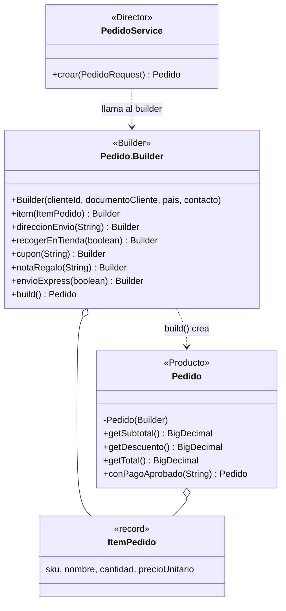
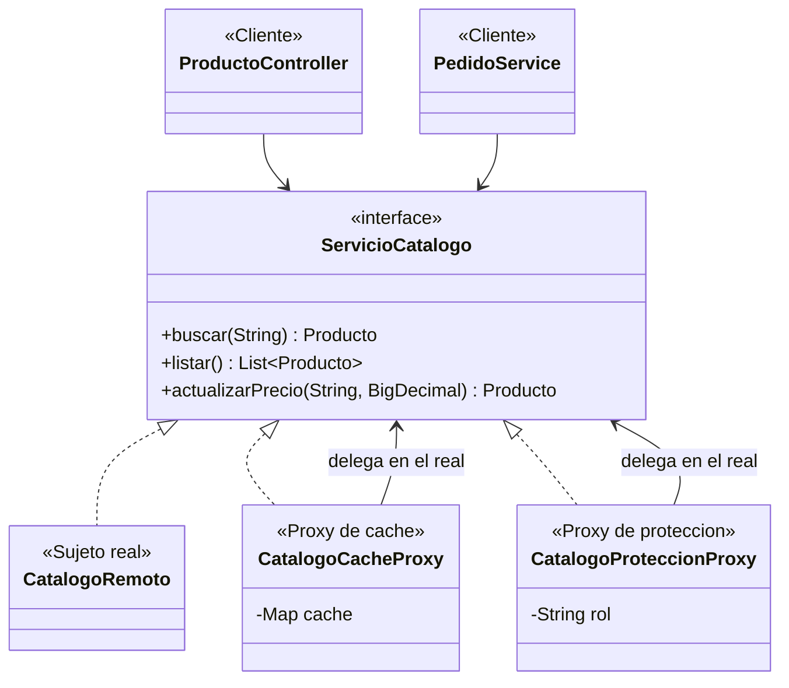
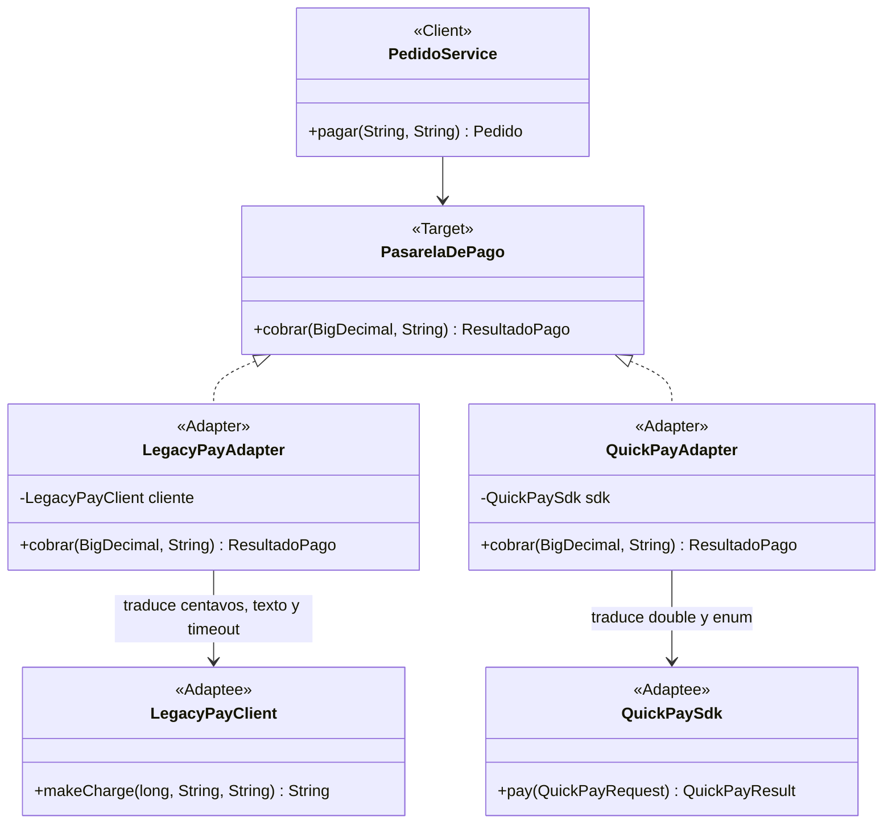
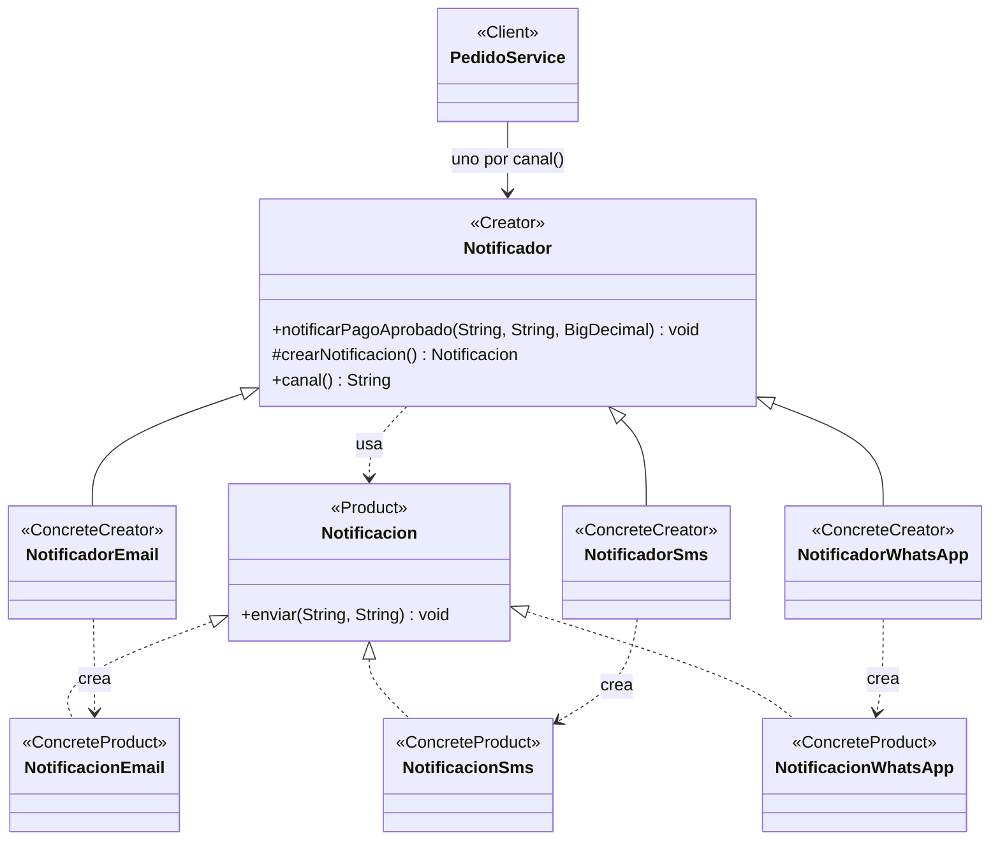

# ShopFlow · proyecto base del taller de patrones de diseño

Ingeniería de Software 2 · Taller: patrones de diseño creacionales y estructurales en una API REST.

## Cómo ejecutar
Requisitos: Java 17 o superior y Maven (o un IDE con soporte para Maven).

```bash
mvn spring-boot:run
```
La API queda en `http://localhost:8080`.

## Qué trae este proyecto
| Paquete | Contenido | ¿Se modifica? |
|---|---|---|
| `externos.legacypay`, `externos.quickpay` | SDK simulados de los proveedores de pago | **No** |
| `catalogo.CatalogoRemoto` | Catálogo de otro equipo (1,5 s por llamada) | **No** |
| `catalogo.ServicioCatalogo`, `Producto` | Interfaz del catálogo y producto | Provisto |
| `pagos.PasarelaDePago`, `ResultadoPago`, `PasarelaNoDisponibleException` | Interfaz destino y tipos propios de ShopFlow | Provisto |
| `pedidos.PedidoRequest` | JSON de entrada de `POST /api/pedidos` | Provisto |
| `notificaciones.BandejaNotificaciones` | Simula el envío de notificaciones | Provisto |
| `comun.ManejadorErrores` | Excepciones → códigos HTTP | Provisto |

Todo lo demás (controladores, servicios, configuraciones y las clases de cada patrón) se implementa durante el taller. Las indicaciones están en el documento del taller (instrucciones y anexos A a D).


## 2. Tabla de análisis de patrones

| Patrón | Problema en ShopFlow (síntoma) | Participantes GoF → clases | Principio SOLID | Cuándo no usarlo |
|---|---|---|---|---|
| *Ejemplo: Strategy* | El costo de envío se calcula con un switch por tipo (estándar, express, recoger en tienda) que crece con cada opción nueva. | Strategy: EstrategiaEnvio. ConcreteStrategy: EnvioEstandar, EnvioExpress. Context: ServicioEnvio. | OCP y DIP. | Si solo hay dos variantes que casi nunca cambian, un if es más claro. |
| Factory Method | Al aprobarse un pago hay que notificar al cliente por el canal que eligió (correo o SMS hoy; WhatsApp después). El proceso es siempre el mismo y lo único que cambia es cómo se crea y se envía cada mensaje. Si PedidoService decide con un if qué clase instanciar, cada canal nuevo obliga a modificarlo. | Product: Notificacion. ConcreteProduct: NotificacionEmail, NotificacionSms, NotificacionWhatsApp. Creator: Notificador. ConcreteCreator: NotificadorEmail, NotificadorSms, NotificadorWhatsApp. Client: PedidoService. | OCP, DIP y SRP. | Cuando hay un solo producto que no cambia, una jerarquía de creadores es más compleja que el new que reemplaza. Conviene empezar con un new y pasar a Factory Method cuando el condicional empiece a repetirse o a crecer. |
| Abstract Factory | Existe una familia de objetos que van juntos: si un pedido se valida con reglas de otro país, la factura queda mal. Si usamos un if en cada clase se mezcla validar un pedido mexicano con reglas colombianas, y al agregar Perú obliga a modificar todo el código. | AbstractFactory: FabricaFacturacion. ConcreteFactory: FabricaColombia, FabricaMexico. AbstractProduct: CalculadoraImpuestos, ValidadorIdentificacion, GeneradorComprobante. ConcreteProduct: implementaciones de cada país. Client: ServicioFacturacion. | OCP y DIP. | Cuando no hay familias de productos, también cuando la familia cambia seguido: agregar un producto nuevo obliga a modificar la interfaz y todas las fábricas. |
| Builder | Un pedido tiene 4 datos obligatorios, al menos un ítem y 6 opciones (dirección, recoger en tienda, cupón, nota de regalo, envío express y canal de notificación), y algunas reglas dependen de varias opciones a la vez. Con un constructor de 11 parámetros es fácil mezclar el orden de dos String, y con setters el pedido puede quedar incompleto o inválido. | Producto: Pedido, inmutable y con constructor privado. Builder: Pedido.Builder, clase estática anidada (versión de Bloch); las reglas se validan en build(). Quien dirige la construcción: PedidoService.crear(PedidoRequest), que traduce el JSON a llamadas al builder. Apoyo: ItemPedido, cuyo precio se toma del catálogo y no del cliente. | SRP: Pedido representa el pedido y Pedido.Builder se encarga de construirlo y validarlo. | Cuando el objeto tiene dos o tres parámetros y todos son obligatorios, porque el builder solo duplicaría código. También hay que mantenerlo cada vez que el pedido cambia de atributos. |
| Adapter | ShopFlow cobra con dos proveedores cuyos SDK no se pueden modificar y no coinciden entre sí ni con el modelo propio. LegacyPay recibe centavos, responde un texto como "00\|LP4051" y lanza su propia excepción por timeout; QuickPay recibe un double y responde con un enum. Sin patrón, los centavos, los códigos y los enums quedan regados por la lógica de negocio, y cambiar de proveedor obliga a reescribirla. | Target: PasarelaDePago. Adapter: LegacyPayAdapter, QuickPayAdapter. Adaptee: LegacyPayClient, QuickPaySdk. Client: PedidoService. | OCP, SRP y DIP. | Cuando se controlan las dos interfaces, porque es más simple alinearlas directamente. También cuando lo que se quiere es simplificar un subsistema completo: eso es Facade. |
| Decorator | LegacyPay falla con timeout casi el 30 % de las veces y hay que reintentar; auditoría exige registrar cada cobro de los dos proveedores. En pruebas los reintentos deben poder apagarse. Con herencia tocaría poner muchas subclases y cada capa nueva duplicaría la cuenta. | Component: PasarelaDePago. ConcreteComponent: LegacyPayAdapter, QuickPayAdapter. Decorator: PasarelaDecorator. ConcreteDecorator: ReintentoPago, AuditoriaPago. | OCP, SRP y LSP. | Cuando hay muy pocas combinaciones. También cuando el cliente depende de tipos concretos. |
| Proxy | El catálogo es de otro equipo y cada consulta tarda 1,5 segundos; un pedido de 3 productos tardaría 4,5 s solo en consultar precios. Además, solo el ADMIN puede cambiar precios, y sin proxy ese control se copiaría en cada lugar que cambia un precio. | Sujeto: ServicioCatalogo. Sujeto real: CatalogoRemoto (simula los 1,5 s de red). Proxy de caché: CatalogoCacheProxy, guarda los productos y solo llama al remoto si el SKU no está en caché; al cambiar un precio actualiza su caché para no servir uno viejo. Proxy de protección: CatalogoProteccionProxy, lanza AccesoDenegadoException (403) si el rol no es ADMIN. Clientes: ProductoController y PedidoService, que reciben un ServicioCatalogo sin saber que es un proxy. | LSP: cada proxy puede reemplazar al catálogo real sin que el cliente lo note. También SRP (la caché y los permisos salen del objeto real) y OCP (se agrega control sin modificar CatalogoRemoto). | Cuando el objeto es barato y local, porque la capa extra no aporta nada. También cuando se necesitan datos siempre frescos y no se puede saber cuándo la caché quedó vieja (por ejemplo, si otro sistema cambia el precio directamente en el catálogo remoto). Y cuando ocultar la red haría creer que una llamada es barata. |


## 3. Patrones: problema, diagrama de clases y endpoint

### Builder

**Problema que resuelve en ShopFlow:** un pedido tiene 4 datos obligatorios, al menos un ítem y 6 opciones, con reglas que dependen de varias opciones a la vez. Con un constructor largo es fácil confundir el orden de los parámetros, y con setters el pedido puede quedar incompleto o inválido. Con el Builder, `build()` valida todo y solo entrega pedidos válidos.

**Endpoint que lo evidencia:** `POST /api/pedidos`. Responde 201 con el pedido, o 400 si rompe alguna regla.



### Proxy

**Problema que resuelve en ShopFlow:** el catálogo es de otro equipo y cada consulta tarda 1,5 segundos. Además, solo un ADMIN puede cambiar precios. Con los proxies, la caché y el control de acceso quedan fuera del catálogo real y ningún cliente se entera de que habla con un intermediario.

**Endpoints que lo evidencian:** `GET /api/productos/{sku}` (la segunda consulta responde casi al instante) y `PUT /api/productos/{sku}/precio` (403 con `X-Rol: CLIENTE`, 200 con `X-Rol: ADMIN`).




### Adapter

**Problema que resuelve en ShopFlow:** ShopFlow cobra con dos proveedores cuyos SDK no se pueden modificar y no coinciden entre sí ni con el modelo propio. LegacyPay recibe el monto en centavos, responde un texto como `"00|LP4051"` y lanza su propia `LegacyPayTimeoutException`. QuickPay recibe un `double` y responde con un enum. Con los adapters, el dominio solo conoce `PasarelaDePago.cobrar(BigDecimal, String)` y recibe un `ResultadoPago`; cambiar de proveedor es agregar otro adapter.

**Endpoint que lo evidencia:** `POST /api/pedidos/{id}/pago` con `{"proveedor": "LEGACYPAY"}` o `{"proveedor": "QUICKPAY"}`. Responde 200 con el pedido pagado, 400 si el proveedor no existe, 404 si el pedido no existe, 409 si el cobro se rechaza (por ejemplo, «Fondos insuficientes» por más de 2.000 USD con LegacyPay) o si el pedido ya estaba pagado, y 503 si la pasarela no responde.



### Factory Method

**Problema que resuelve en ShopFlow:** al aprobarse un pago se notifica al cliente por el canal que eligió. El proceso es siempre el mismo (armar el mensaje, crear la notificación del canal y enviarla) y lo que cambia es la notificación: un correo exige un contacto con «@» y lleva asunto, un SMS se recorta a 160 caracteres y WhatsApp exige un número con indicativo. Si `PedidoService` eligiera con un `if` qué clase instanciar, cada canal nuevo obligaría a modificarlo. Con el Factory Method, `Notificador.notificarPagoAprobado()` fija el proceso y cada subclase decide qué `Notificacion` crea. `PedidoService` recibe la lista de notificadores y los indexa por `canal()`.

**Endpoints que lo evidencian:** `GET /api/notificaciones` muestra las notificaciones enviadas con su canal y el total pagado. `POST /api/pedidos` responde 400 si el pedido trae un `canalNotificacion` que ningún notificador atiende.




## 4. Retos de extensión

### Reto C · WhatsApp (Factory Method)

Se agregaron `NotificacionWhatsApp` (exige un número con indicativo, por ejemplo `+573001234567`, y antepone ✅ al mensaje) y `NotificadorWhatsApp` (`@Component`, `canal()` devuelve `"WHATSAPP"`). No se modificó ninguna clase existente: Spring inyecta el nuevo notificador en la lista que recibe `PedidoService`, que ya los indexa por canal, así que un pedido con `"canalNotificacion": "WHATSAPP"` se notifica sin tocar nada más.

Evidencia de que solo hay archivos nuevos: la salida de `git diff --stat` del commit del reto está en `evidencias/reto-c-git-diff-stat.txt`.


## 5. Preguntas de reflexión

**1. Escriba cómo habría quedado `PedidoService` sin Factory Method ni Abstract Factory: ¿cuántos `if` tendría y qué clases habría que modificar para abrir Perú y agregar WhatsApp?**

Sin los patrones, `PedidoService` tendría que decidir con `if` en dos frentes. Para notificar, un `if` por canal que hace el `new` de la notificación: 2 ramas hoy (correo y SMS) y 3 con WhatsApp. Para facturar, un `if` por país en cada una de las tres piezas (calcular el impuesto, validar el documento y generar el comprobante): 2 países por 3 piezas son 6 ramas hoy y 9 con Perú. En total serían unas 8 ramas hoy y 12 con Perú y WhatsApp, todas en la misma clase.

Para abrir Perú y agregar WhatsApp habría que editar `PedidoService` en cada uno de esos `if` (y cualquier otra clase que también pregunte por el país o el canal), con el riesgo de romper lo que ya funcionaba. Con los patrones no se modifica ninguna clase existente: Perú es `FabricaPeru` y WhatsApp es `NotificadorWhatsApp`, y ni `PedidoService` ni `ServicioFacturacion` se enteran, porque reciben las fábricas y los notificadores por inyección y los indexan por `pais()` y `canal()`.

**2. ¿Por qué las notificaciones usan Factory Method y la facturación usa Abstract Factory? Responda con la diferencia entre crear un producto y crear una familia de productos.**

La diferencia está en cuántos objetos hay que crear y qué tienen que cumplir entre ellos. En las notificaciones se crea un solo producto: la `Notificacion` del canal. El proceso (armar el mensaje y enviarlo) es siempre igual, y la subclase (`NotificadorEmail`, `NotificadorSms`) decide cuál crea sobrescribiendo `crearNotificacion()`. Eso es Factory Method y funciona por herencia.

En la facturación se crea una familia de productos que tienen que ir juntos: la calculadora de impuestos, el validador de documento y el generador de comprobante del mismo país. Si se mezclan (el IVA de Colombia con el CFDI de México), la factura queda mal. `ServicioFacturacion` recibe una `FabricaFacturacion` que entrega las tres piezas ya emparejadas, y eso es Abstract Factory, que funciona por composición. Si solo se elige un objeto, es Factory Method; si hay que garantizar que varios objetos sean compatibles entre sí, es Abstract Factory.

**3. Invierta el orden de los decoradores (reintento por fuera de la auditoría) y pague cinco pedidos con LegacyPay. ¿Qué cambia en `GET /api/pagos/auditoria`? ¿Qué orden conviene y por qué?**

Respuesta:

**4. `CatalogoCacheProxy` y `AuditoriaPago` tienen casi la misma estructura: implementan la interfaz y envuelven un objeto. ¿Por qué uno es Proxy y el otro Decorator?**

Aunque tienen la misma estructura, la diferencia está en la intención. `CatalogoCacheProxy` controla el acceso al catálogo remoto: decide si llama o no al objeto real. Si el SKU ya está en caché, responde sin llamar al `CatalogoRemoto`. El cliente no recibe nada nuevo, solo obtiene la misma respuesta más rápido. `AuditoriaPago` siempre delega en la pasarela y además agrega una responsabilidad nueva: registrar cada cobro con su duración y su resultado. Si el envoltorio controla si, cuándo o cómo se llega al objeto real, es Proxy. Si le agrega funcionalidad que el cliente quiere, es Decorator.

**5. Si otro sistema cambia un precio directamente en el catálogo remoto, ¿qué problema tiene la caché del proxy? Proponga una solución.**

La caché solo se entera de los cambios que pasan por ella (cuando se llama a `actualizarPrecio` en el proxy). Si otro sistema cambia el precio directamente en el catálogo remoto, la caché sigue guardando el precio viejo y lo sirve, por lo que un pedido podría calcularse con un precio desactualizado. Una solución sencilla es que cada producto guardado en caché tenga un tiempo de vida (TTL), por ejemplo unos minutos, y cuando venza se vuelva a consultar al catálogo remoto. Otra opción es que el catálogo remoto avise cuando cambia un precio para invalidar esa entrada de la caché.

**6. `QuickPayAdapter` convierte `BigDecimal` a `double`. ¿Qué riesgo trae y por qué conviene que esa decisión viva en el adapter y no en el dominio?**

El riesgo es que un `double` guarda los decimales en binario y casi ninguno queda exacto: `19.99` se almacena como 19.9899999999999984…, así que si el SDK lo multiplica por 100 y trunca, obtiene 1998 centavos en vez de 1999. En dinero eso es un centavo perdido, y con muchas operaciones se acumula. En este ejercicio el SDK de QuickPay solo compara el monto contra 0 y 5.000, así que no pasa nada, pero el riesgo es real con cualquier SDK que calcule con ese número.

Conviene que la conversión viva en el adapter porque ahí está la frontera con el SDK. El dominio (`Pedido`, `ResultadoPago`, `PasarelaDePago`) sigue trabajando con `BigDecimal`, que es exacto, y solo `QuickPayAdapter.cobrar()` asume la pérdida de precisión, en un único lugar. Si QuickPay mañana acepta centavos o texto, solo cambia el adapter.

**7. ¿En qué parte del proyecto **no** convenía aplicar un patrón? Justifique con el criterio «cuándo no usarlo» del Anexo A.**

Respuesta: 

**8. Para cada patrón, indique el principio SOLID que aplica y cite la clase o la línea de código que lo evidencia.**

- **Factory Method:** OCP y DIP. `PedidoService` guarda un `Map<String, Notificador>` armado con la lista que recibe y no tiene ningún `new Notificacion…` ni un `if` por canal: depende de la abstracción `Notificador`. Agregar WhatsApp (reto C) fueron dos clases nuevas, `NotificadorWhatsApp` y `NotificacionWhatsApp`, y ninguna modificación. Además se cumple SRP: la creación de cada notificación queda aislada en `crearNotificacion()`.
- **Abstract Factory:** :
- **Builder:** SRP. `Pedido` solo representa el pedido (inmutable, con constructor privado y sin setters), y `Pedido.Builder` se encarga de armarlo y validarlo. Las reglas están todas en un solo lugar, el método `build()`.
- **Adapter:** DIP, SRP y OCP. `PedidoService.pagar()` depende de la interfaz `PasarelaDePago` (`pasarelas.get(...).cobrar(...)`) y nunca de `LegacyPayClient` ni de `QuickPaySdk`. La conversión vive en una sola clase por proveedor: `LegacyPayAdapter.cobrar()` pasa a centavos, interpreta `"00|LP4051"` y traduce el timeout, y `QuickPayAdapter.cobrar()` pasa a `double` y traduce el enum. Un proveedor nuevo es un adapter nuevo.
- **Decorator:** : 
- **Proxy:** LSP. `CatalogoCacheProxy` y `CatalogoProteccionProxy` implementan `ServicioCatalogo`, así que pueden reemplazar a `CatalogoRemoto` sin que `ProductoController` ni `PedidoService` lo noten. Además se cumple OCP: en `ConfiguracionCatalogo` el bean `new CatalogoCacheProxy(new CatalogoRemoto())` agrega la caché sin modificar `CatalogoRemoto`.