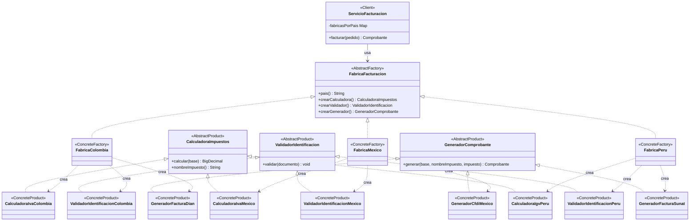
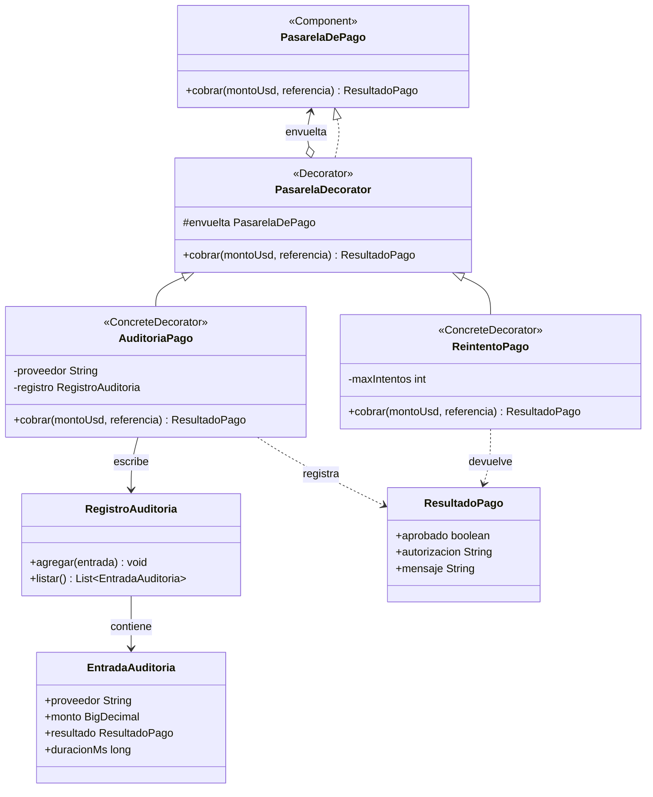

# Análisis de patrones: Abstract Factory y Decorator

Taller de patrones de diseño — Ingeniería de Software 2  
Proyecto: **ShopFlow**

---

## Tabla de análisis

| Patrón | Problema en ShopFlow | Participantes GoF → clases | Principio SOLID | Cuándo **no** usarlo |
|---|---|---|---|---|
| **Abstract Factory** | Cada país exige una combinación distinta de calculadora de impuestos, validador de identificación y generador de comprobante. Sin el patrón, el servicio de facturación necesitaría `if/switch` por país para instanciar cada pieza, acoplando el dominio a implementaciones concretas y rompiendo OCP cada vez que se agrega un mercado. | AbstractFactory: `FabricaFacturacion`. ConcreteFactory: `FabricaColombia`, `FabricaMexico`, `FabricaPeru`. AbstractProduct: `CalculadoraImpuestos`, `ValidadorIdentificacion`, `GeneradorComprobante`. ConcreteProduct: `CalculadoraIvaColombia`, `CalculadoraIvaMexico`, `CalculadoraIgvPeru`; `ValidadorIdentificacionColombia`, `ValidadorIdentificacionMexico`, `ValidadorIdentificacionPeru`; `GeneradorFacturaDian`, `GeneradorCfdiMexico`, `GeneradorFacturaSunat`. Client: `ServicioFacturacion`. | **OCP** — agregar un país es añadir una fábrica sin tocar `ServicioFacturacion`. **DIP** — el cliente depende solo de interfaces abstractas, nunca de clases concretas. | Solo hay un contexto (un único país) y no se anticipa expansión; o las familias de productos varían de forma independiente (Abstract Factory fuerza que todas las piezas cambien juntas). |
| **Decorator** | Las pasarelas de pago necesitan comportamientos ortogonales —reintentos ante fallos transitorios y registro de auditoría— que deben combinarse en cualquier orden sin multiplicar subclases. La herencia produciría una explosión: `PasarelaConReintento`, `PasarelaConAuditoria`, `PasarelaConReintentoyAuditoria`, etc. | Component: `PasarelaDePago`. Decorator: `PasarelaDecorator`. ConcreteDecorator: `ReintentoPago`, `AuditoriaPago`. ConcreteComponent: cualquier clase que implemente `PasarelaDePago` directamente (p. ej. adaptadores). | **OCP** — nuevos comportamientos se añaden como decoradores sin modificar los existentes. **SRP** — `ReintentoPago` solo gestiona reintentos; `AuditoriaPago` solo registra. **LSP** — cada decorador es sustituible en cualquier posición de la cadena porque implementa `PasarelaDePago`. | La cadena de decoradores sería siempre fija y nunca se reordena; en ese caso, un simple método de plantilla o un único objeto con ambas responsabilidades es más legible. |

---

## Abstract Factory

### Problema que resuelve

`ServicioFacturacion` debe generar comprobantes fiscalmente correctos para Colombia, México y Perú (y cualquier mercado futuro) sin conocer las reglas de cada uno. Cada país requiere una **familia de objetos relacionados**: una calculadora de impuestos específica, un validador del documento fiscal del cliente y un generador del comprobante oficial. El patrón encapsula esa familia detrás de `FabricaFacturacion`; Spring inyecta la lista completa de fábricas y el servicio selecciona la correcta por código de país en tiempo de ejecución.

### Diagrama de clases



### Endpoint que lo evidencia

`POST /api/pedidos` — cuando el body incluye `"pais": "CO"` (o `"MX"` o `"PE"`), `ServicioFacturacion.facturar()` selecciona la fábrica correcta del mapa, crea la familia de productos adecuada y retorna el `Comprobante` con el tipo, número y cálculo de impuesto propios de ese país. Agregar un nuevo mercado requiere únicamente crear un nuevo paquete con una `@Component` que implemente `FabricaFacturacion`; el servicio lo detecta automáticamente en el arranque de Spring.

---

## Decorator

### Problema que resuelve

Los cobros a través de una `PasarelaDePago` necesitan dos comportamientos adicionales que son **independientes entre sí** y deben poder **combinarse en cualquier orden**:

- **`ReintentoPago`**: reintenta el cobro hasta `maxIntentos` veces si la pasarela lanza `PasarelaNoDisponibleException`; los rechazos normales (fondos insuficientes) no se reintentan.
- **`AuditoriaPago`**: registra cada llamada en `RegistroAuditoria` con proveedor, monto, resultado y duración en ms.

El orden importa: `AuditoriaPago(ReintentoPago(pasarela))` registra solo el resultado final; `ReintentoPago(AuditoriaPago(pasarela))` registra cada intento individual. Ambas configuraciones son válidas y las pruebas de `AuditoriaPagoTest` documentan exactamente esta diferencia.

### Diagrama de clases



### Endpoint que lo evidencia

`GET /api/pagos/auditoria` — `AuditoriaController` inyecta `RegistroAuditoria` y devuelve como JSON la lista de `EntradaAuditoria` acumuladas durante los cobros. Cada entrada es el rastro dejado por el decorador `AuditoriaPago` al envolver una pasarela real. El endpoint no sabe nada de `ReintentoPago`; la composición de decoradores ocurre en la capa de configuración de Spring, no aquí.

---

## Retos de extensión

### Perú

Se agregó soporte para Perú **sin modificar ninguna clase existente**, siguiendo el principio OCP:

- `facturacion/peru/FabricaPeru.java` — `@Component`, `pais() = "PE"`
- `facturacion/peru/CalculadoraIgvPeru.java` — IGV 18 %, redondeo `HALF_UP` a 2 decimales
- `facturacion/peru/ValidadorIdentificacionPeru.java` — RUC de exactamente 11 dígitos
- `facturacion/peru/GeneradorFacturaSunat.java` — tipo `"Factura electrónica (SUNAT)"`, numeración `FE-PE-n`

`ServicioFacturacion` detectó `FabricaPeru` automáticamente al arrancar Spring, sin ningún cambio en su código.

Salida de `git diff --stat`:

```
# Pegar aquí la salida de: git diff --stat HEAD~1
```

### Métricas

_Espacio reservado para métricas adicionales (cobertura de pruebas, número de clases por patrón, líneas de código, etc.)._
